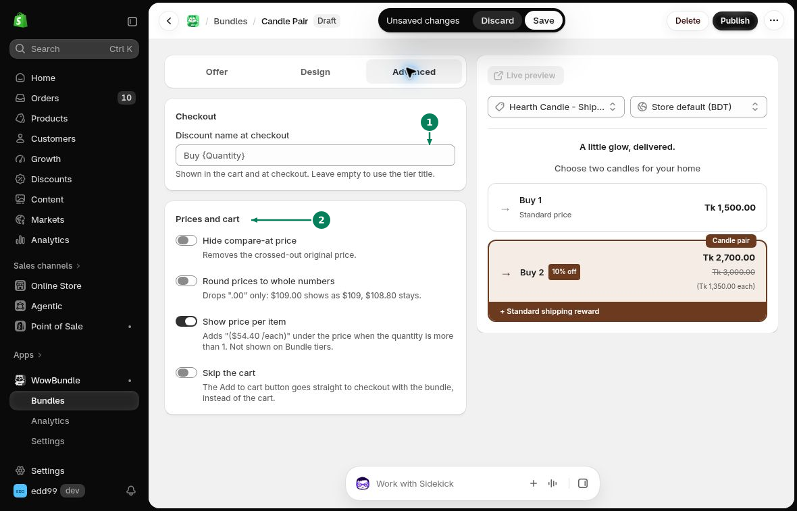

# Checkout and Price Display

Use **Advanced** to change the discount name and how prices appear in your offer.

## Checkout

**Discount name at checkout** is the discount name shown in the cart and at checkout. Enter a name, or leave it empty to use the tier title.

## Prices and cart

- **Hide compare-at price**: Hide the crossed-out original price.
- **Round prices to whole numbers**: Hide “.00” only. For example, 109.00 appears as 109, while 108.80 keeps its decimals.
- **Show price per item**: Show a price below the total when the quantity is more than one. This is not shown on **Bundle (Different products)** tiers.
- **Skip the cart**: Send customers straight to checkout when they click Add to cart. See [Direct Checkout](skip-cart.md).

1. Set the discount name. 2. Choose the price and cart options.

If customers can choose items with different prices, turn off **Show price per item** when a single amount could be confusing.

Click **Save** after making changes.
