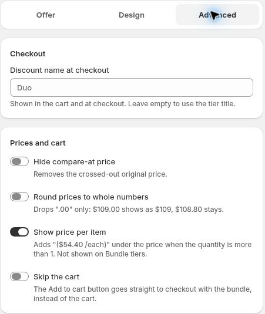

# Advanced Settings

Adjust checkout naming and price presentation without changing your offer text.

## Discount name at checkout

Enter the name you want to use for the discount at checkout. Leave it empty to use the tier title. Save and inspect the resulting checkout summary.

## Hide compare-at price

Enable this option to hide the crossed-out original price. Check that the remaining price and savings text are still clear.

## Round prices to whole numbers

This display option removes **.00**. For example, 34.00 can display as 34, while 19.99 keeps its decimals.

## Show price per item

Use this option to show or hide unit-price text. It is not displayed for Bundle tiers.

## Skip the cart

Enable **Skip the cart** when you want the purchase flow to continue directly to checkout. See [Direct Checkout](skip-cart.md).

Save and reopen the bundle after changing these settings, then check the relevant storefront or checkout view.

Checkout naming and price-display controls. Duo is the field placeholder shown here.
