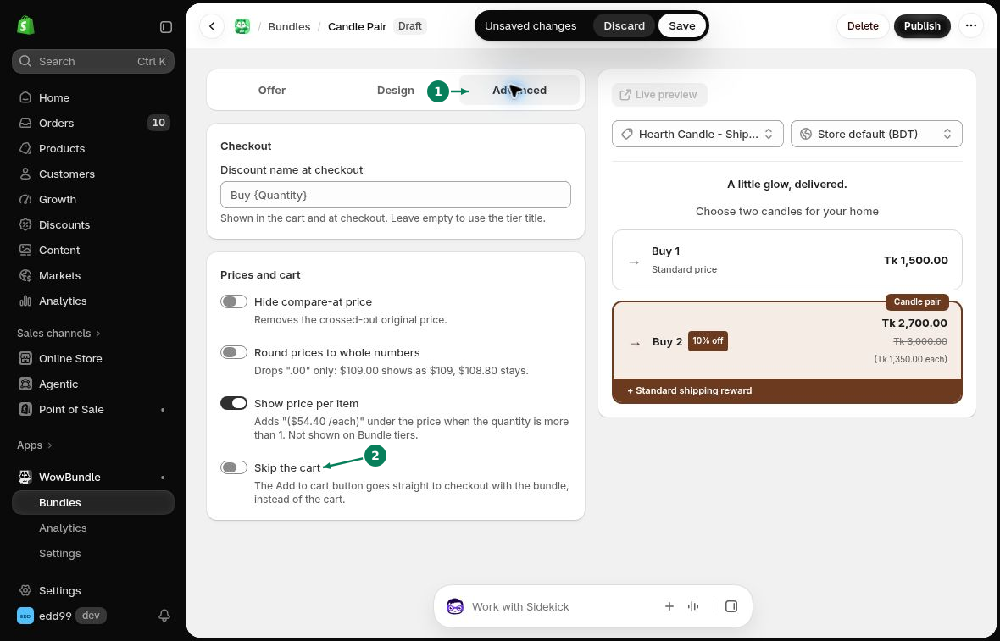

# Direct Checkout

Send customers straight to checkout after they add a bundle.

## Turn on Skip the cart

1. Open your bundle and select **Advanced**.
2. Under **Prices and cart**, turn on **Skip the cart**.
3. Click **Save**.

## Try the checkout flow

Open a product page that shows your bundle. Choose a tier, then click **Add to cart**.

Checkout should open with the selected bundle. Review the items, discount, and total. You do not need to place an order.

To return customers to the cart first, turn off **Skip the cart** and click **Save**.
