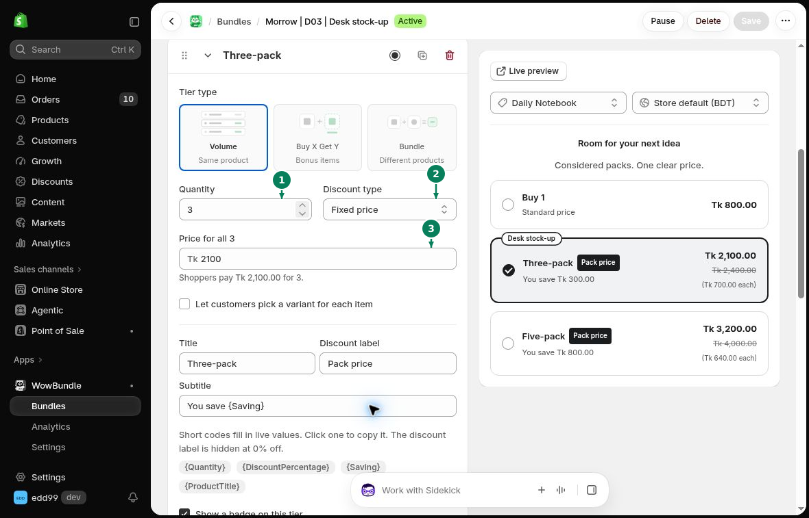

# Discount Settings

Choose how the price changes for each tier. Open a **Volume** tier to find **Discount type**.

## Discount type

- **No discount:** use the product price without a bundle discount.
- **% off:** reduce each item's price by a percentage. Two items priced at 20 each cost 36 with 10% off.
- **Amount off each:** subtract an amount from every item. Two items priced at 20 each cost 30 with 5 off each.
- **Fixed price:** set one total for the Volume tier. A quantity of 3 with a fixed price of 45 costs 45 for all three items.

## Fixed price

1. Set **Quantity** to the number of items in the pack.
2. Choose **Fixed price**.
3. Enter the pack total. For three items, the field reads **Price for all 3**.

## Other bundle types

In **Buy X Get Y**, set **Discount** separately under **Customer buys (X)** and **Customer gets (Y)**. Choose **Free** for Y when the received items should cost nothing.

In **Bundle**, each product has its own **Discount**. Set each component's discount to get the total you want.

## Check the total

Select the products and variants in the preview, then check the price. If variants have different prices, try more than one combination.

After saving, add the offer to the cart and compare the items and total. See [cart prices](../troubleshooting/cart-prices.md) if the amount is unexpected.
