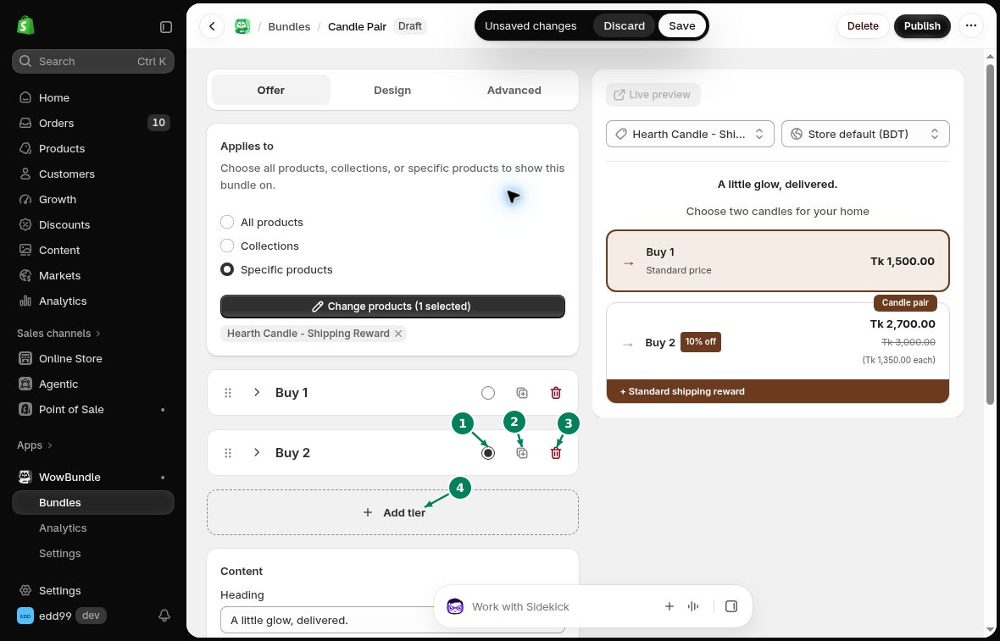

# Manage Tiers

Tiers are the choices inside a bundle offer. Give each tier its own products, quantity and price.

## Edit a tier

Open **Offer** and expand a tier. Choose its **Tier type**, then set the products, quantity and discount.

Use a clear **Title**, such as “2 pack,” that matches the number of items. Add a **Subtitle** if customers need more detail.

## Add, duplicate or delete

- **Add tier (4):** add another choice to the offer.
- **Duplicate (2):** copy a tier so you can adjust its settings.
- **Delete (3):** remove a tier from the offer.

After duplicating a tier, change its title, quantity and price before saving.

## Reorder tiers

Drag a tier by its reorder handle to move it. You can also focus the handle and use the **up** and **down arrow keys**. Save the new order when you finish.

## Selected by default

Choose **Selected by default (1)** on the tier you want customers to see selected first.

Opening another tier changes the editor preview. It does not change the saved default selection.

Click **Save** when you finish. Reopen the offer to check the saved choices.
