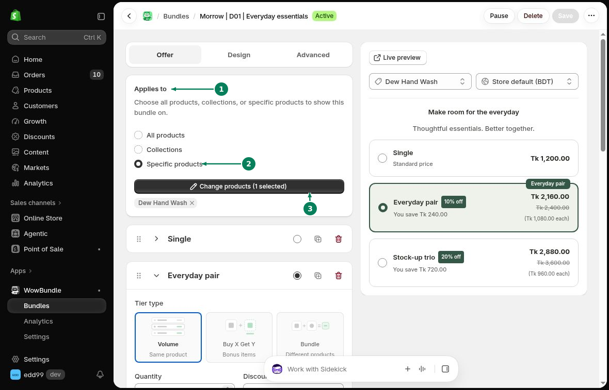

# Choose Products

Use **Applies to** to choose which product pages show your bundle.

## Applies to

Open the bundle's **Offer** tab. Under **Applies to (1)**, choose one option:

- **All products:** show the offer across your products.
- **Collections:** show the offer on products in the collections you select.
- **Specific products (2):** show the offer on individual products you select.

For **Collections**, open **Select collections**, use **Search collections** to find the collections you want, then click **Select**. For **Specific products**, select the products you want to include. To update an existing product selection, click **Change products (3)**. The button shows how many products are selected.

## Check the selected products

Save your changes. Open a product included in the offer and check that the bundle appears. Also open a product outside the selection to make sure it is excluded.

These settings choose where the offer appears. For a mixed-product bundle, choose the products sold in the set under [Products in this bundle](../bundle-types/mixed-bundles.md).

If more than one active offer includes a product, check which one appears on its page.
