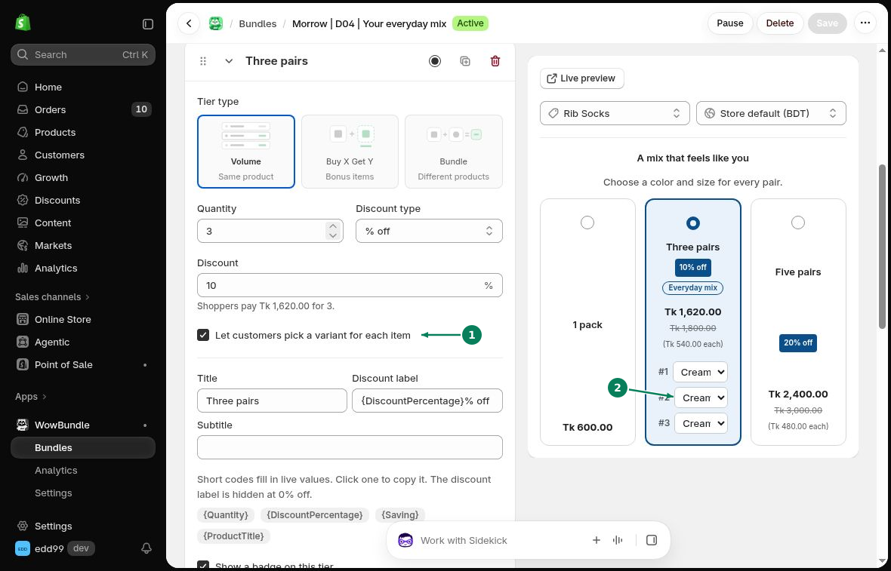

# Variant Selection

Let customers choose a size, color or other variant for each item in a quantity tier.

## Let customers pick a variant for each item

Open a **Volume** tier in **Offer**. Turn on **Let customers pick a variant for each item (1)**, then click **Save**.

Customers can now use a separate **variant selector (2)** for each item within the selected tier.

## Check variant prices

Open a product page with several variants. Choose a different variant for each item and add the tier to the cart. Check the variant names, quantities and prices.

If variants have different prices, the combined total can change with the selection. For example, variants priced at 20 and 30 total 45 with 10% off.

## Check availability

Keep the products and variants in your offer available in Shopify. Check their stock, sales channels and selling settings.

After changing product options or variants, check any bundles, gifts and upsells that use them. Open the product page again to make sure customers can choose the intended items.

A product listed in the editor may not be available in every storefront or market. See [markets and currencies](../troubleshooting/markets.md).
