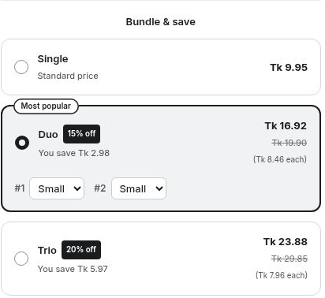

# Variant Selection

Let customers choose the variant for each item in a quantity tier.

## Step 1: Enable per-item selection

Open a Volume tier and enable **Let customers pick a variant for each item**.

Enable the per-item variant picker beneath the tier pricing controls.

## Step 2: Save and preview

Save the offer and open a product with multiple variants. Choose the variants customers should be able to combine.

Per-item variant choices appear within the selected tier.

## Step 3: Check the cart

Add the tier and confirm each variant, quantity and price. If variant prices differ, check the combined total too.

## Keep availability current

Review Shopify publication, inventory and continue-selling settings for the products in your offer. After changing stock, reload the product page before checking availability.

Changing product options can replace variant IDs. Recheck existing gifts, upsells and mixed bundles after such changes.

A product appearing in an editor selector does not necessarily mean it is available for purchase in every storefront or market.
