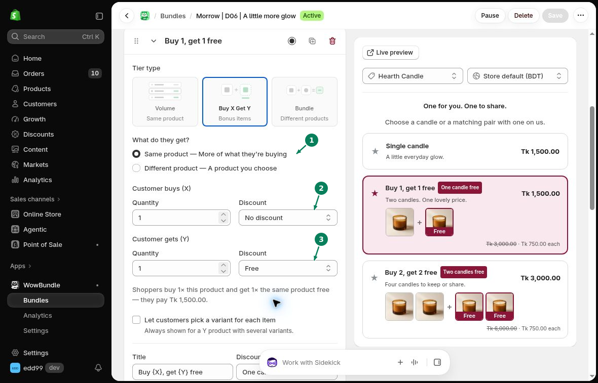

# Buy X Get Y

Set the items customers buy and the items they get with the purchase. The received items can be free or discounted.

## Choose the received product

Open a tier and choose **Buy X Get Y** under **Tier type**. Under **What do they get?**, choose:

- **Same product (1):** more of the product the customer is buying.
- **Different product:** a product you select.

For **Different product**, choose the product to include.

## Set the quantities and discounts

- **Customer buys (X) (2):** set the bought **Quantity** and **Discount**.
- **Customer gets (Y) (3):** set the received **Quantity** and **Discount**.

For Y, choose **Free**, **% off**, **Amount off each** or **Fixed price**.

To create “Buy 1, get 1 free,” set X to **1** with **No discount** and Y to **1** with **Free**. The customer receives two items and pays for one.

## Check the title and cart

Write a **Title** that matches the offer. Only call the received item free when its discount is **Free**.

For a discounted Y item, check both its label and price on the product page. If it is labeled free, do not use that offer until the wording is corrected.

Save the bundle and check it on a matching product page. Add it to the cart, then remove the bought item. A received item can remain in the cart at its regular price when the offer no longer qualifies.

A tier's **Free gift** is separate from the Y items. [Learn about free gifts](../gifts-upsells/free-gifts.md).
