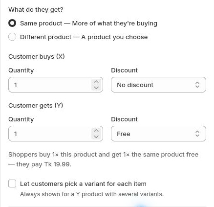

# Buy X Get Y

Create an offer with a quantity customers buy and a quantity they receive.

For example, offer “Buy 1, get 1 free” on the same product, or pair a main product with a different bonus product.

## Step 1: Choose Buy X Get Y

Open the tier and select **Buy X Get Y · Bonus items**.

## Step 2: Choose the received product

Under **What do they get?**, select **Same product** or **Different product**. For a different product, select the product shoppers receive.

## Step 3: Configure X and Y

Set the **Customer buys (X)** quantity and discount. Then set the **Customer gets (Y)** quantity and discount.

The received item does not have to be free. If you charge for it, update any title that says “free.” The editor warns when the title and received-item price disagree.

Choose the received product and configure the bought and received quantities.

## Step 4: Review and publish

Use {X} and {Y} in supported title fields, review the combined price, then save and publish.

Check what happens when a customer changes or removes the paid quantity. A lower quantity does not necessarily switch to a lower Buy X Get Y tier. Also review any separate **Free gift** add-on; it is additional to the Y items.
