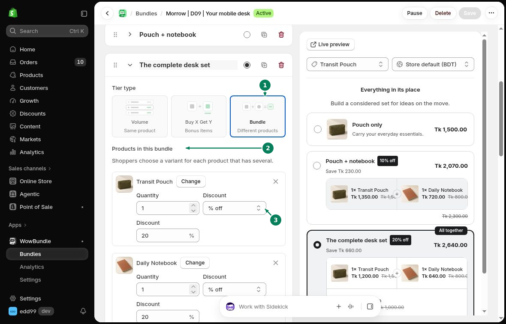

# Mixed-product Bundles

Combine different products in one fixed set. For example, offer a pouch, notebook and pen together.

## Add products to the set

Open a tier in **Offer**.

1. Choose **Bundle** under **Tier type**.
2. Under **Products in this bundle**, click **Add product** and choose a product.
3. Set the product's **Quantity** and **Discount**.

Repeat for the other products in the set.

Use **Change** to replace a product. Use the remove icon beside a product to take it out of the set. Customers can choose a variant for each product that has several variants.

## Set the price

Each product has its own discount. To give the whole set 20% off, choose **% off** and enter **20** for every product.

Write a **Title** and **Subtitle** that explain what is included. Check the preview's products, quantities and total before saving.

## Check the cart

Add the set from a product page. Confirm that each product appears with the right quantity and price.

Remove one product and check the remaining prices. Items may return to their regular prices when the set is incomplete.
