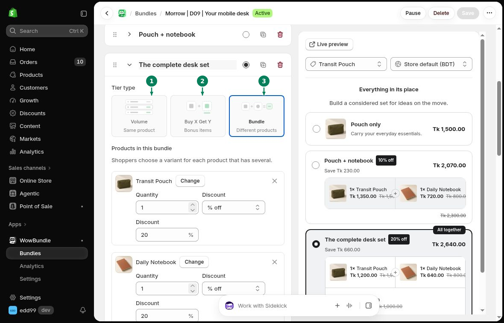

# Bundle Types

Each tier has a **Tier type**. Choose the type based on what the customer receives.

## Volume

Use **Volume (1)** for several items of the same product. For example, sell one bottle at the regular price or two bottles at 10% off.

[Set up quantity breaks](quantity-breaks.md).

## Buy X Get Y

Use **Buy X Get Y (2)** to set separate bought and received quantities. The extra items can be the same product or a different product, free or discounted.

[Set up Buy X Get Y](buy-x-get-y.md).

## Bundle

Use **Bundle (3)** for a fixed set of different products. Set the quantity and discount for each product in the set.

[Set up a mixed-product bundle](mixed-bundles.md).

