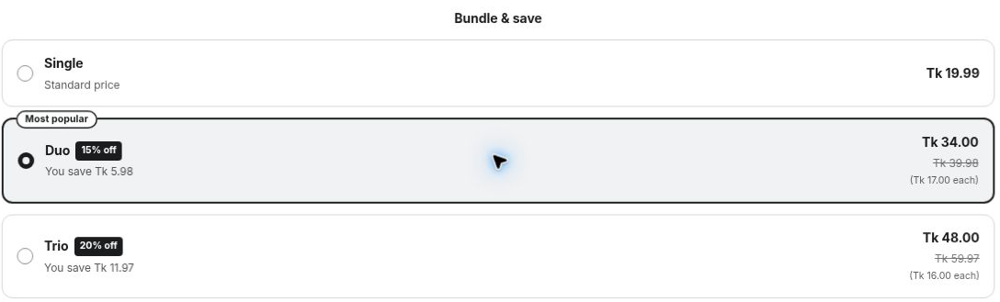
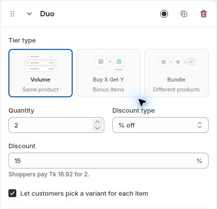

# Quantity Breaks

Give customers a reason to choose a larger quantity of the same product.

For example, a skincare store can offer one bottle at its regular price, two at a discount and three at a larger discount.

A product-page quantity offer with Single, Duo and Trio choices.

## Step 1: Choose Volume

Create a quantity design or open an existing tier. Select **Volume · Same product**.

## Step 2: Set the quantity and discount

Enter **Quantity**, then select **No discount**, **% off**, **Amount off each** or **Fixed price**. Enter the value and review the helper text and preview.

Repeat for your other tiers. Keep each title consistent with its quantity and price.

Set the quantity, discount and per-item variant selection. The helper amount depends on the selected preview product.

## Step 3: Choose variants and a default

If shoppers should choose each unit's variant, enable **Let customers pick a variant for each item**. Select the tier that should be chosen by default.

## Step 4: Save and review

Save and publish the offer to your intended products. Add a tier to cart, then change the quantity above and below its threshold to check the resulting price.

Learn more about [discount modes](../bundle-settings/discounts.md) and [variant selection](../bundle-settings/variants-inventory.md).
