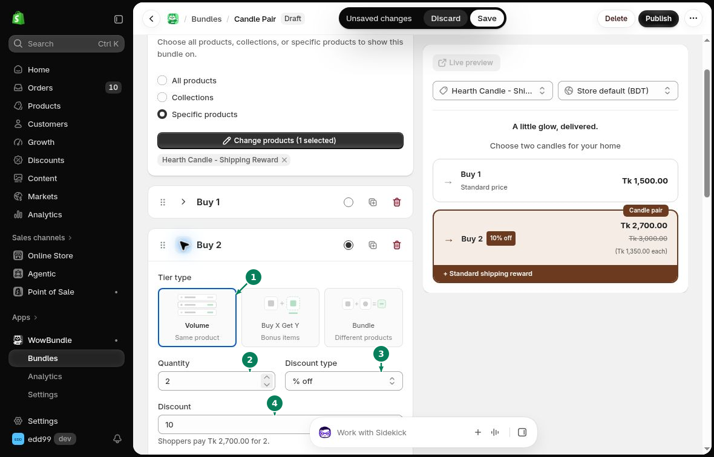

# Quantity Breaks

Offer several quantities of the same product, each with its own price. For example, offer one candle at the regular price and two candles at 10% off.

## Set the quantity and price

Open a tier in **Offer**.

1. Under **Tier type**, choose **Volume**.
2. Enter the number of items in **Quantity**.
3. Choose a **Discount type**.
4. Enter the discount value in **Discount**.

- **No discount:** keep the regular price.
- **% off:** take a percentage off each item.
- **Amount off each:** take a fixed amount off each item.
- **Fixed price:** set the total price for the tier's quantity.

For **Fixed price**, the field names the full quantity. **Price for all 3** is the total for three items.

## Add more choices

Click **Add tier** for another quantity. Set its quantity, discount and **Title**. Choose **Selected by default** on the tier customers should see selected first.

To let customers mix sizes or colors, turn on **Let customers pick a variant for each item**.

## Check the offer

Save your changes. On the product page, select each tier and check its quantity and total. Add it to the cart, then reduce the quantity to check the new price.

See [discount settings](../bundle-settings/discounts.md) and [variant selection](../bundle-settings/variants-inventory.md).
