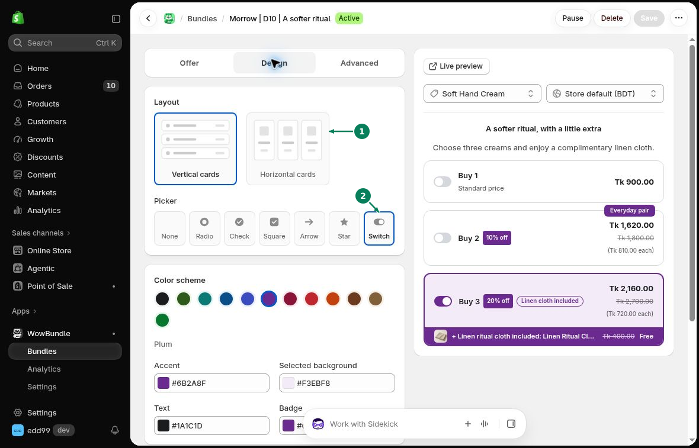
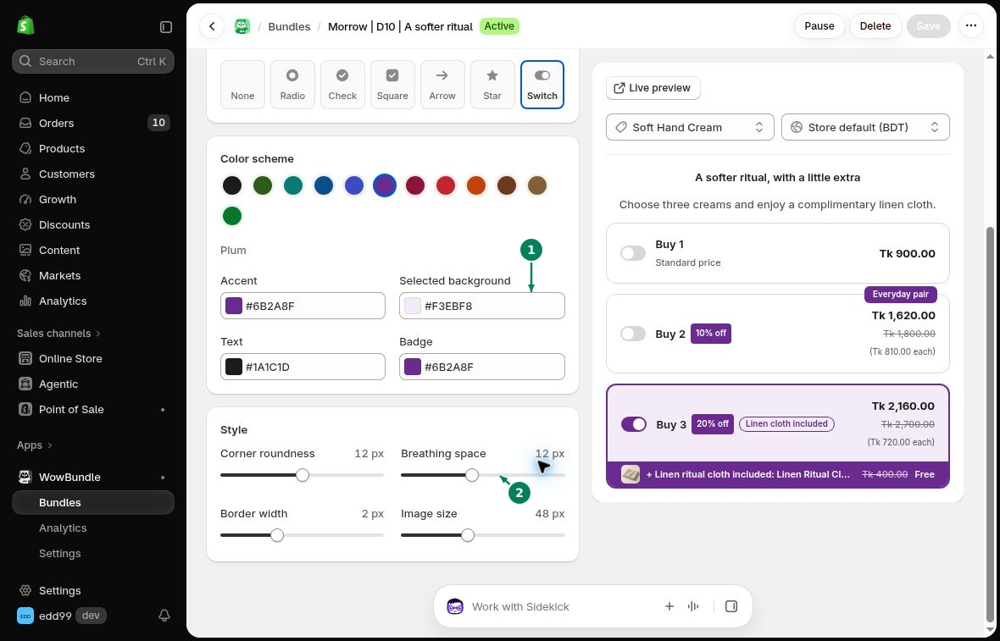

# Design Settings

Use the **Design** tab to change your bundle's layout, colors, and spacing.

## Layout

- **Vertical cards**: Stack the tiers one above another.
- **Horizontal cards**: Place the tiers side by side.

### Picker

Choose how customers select a tier: **None**, **Radio**, **Check**, **Square**, **Arrow**, **Star**, or **Switch**.

1. Choose the layout. 2. Choose the picker.

## Color scheme

Choose a preset color scheme, or change the individual colors:

- **Accent**: The offer's main highlight color.
- **Selected background**: The background of the selected tier.
- **Text**: The text color.
- **Badge**: The badge color.

## Style

- **Corner roundness**: How rounded the card corners are.
- **Breathing space**: The space around the content.
- **Border width**: The thickness of the borders.
- **Image size**: The size of images in the offer.

1. Set the colors. 2. Adjust the shape and spacing.

Click **Save** when you're happy with the preview. Use [Mobile Preview](mobile-preview.md) to see how the offer fits on a narrow screen.
