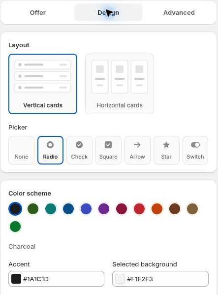

# Design Settings

Choose how your offer looks from the Design tab.

## Layout

Choose **Vertical** for stacked cards or **Horizontal** for side-by-side choices. Preview both at the widths your customers use.

## Picker style

Choose **None**, **Radio**, **Check**, **Square**, **Arrow**, **Star** or **Switch**. Check that the selected tier is clear.

## Color scheme

Available schemes include Charcoal, Forest, Teal, Ocean, Indigo, Plum, Wine, Red, Orange, Cocoa, Sand and WowBundle green.

For a custom palette, adjust **Accent**, **Selected background**, **Text** and **Badge**. Use **Reset to scheme colors** to return to the selected scheme's colors.

Choose a layout, picker and color scheme.

## Shape and spacing

Adjust **Corner roundness**, **Breathing space**, **Border width** and **Image size**. Keep text readable and the selected state visible.

Save your changes, reopen the bundle and check the result on your product page. Theme-block placement settings do not replace these appearance controls.
