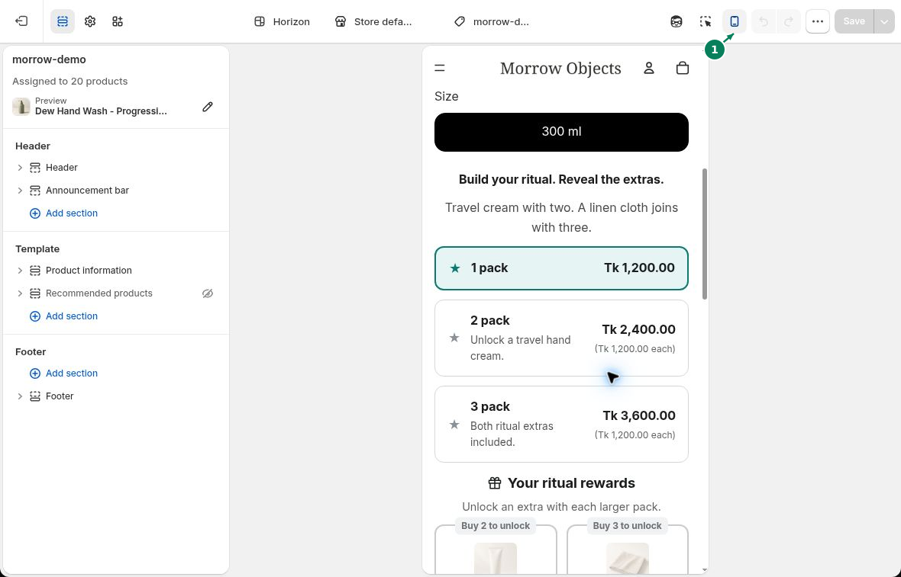

# Mobile Preview

Use your theme's mobile preview to see how the bundle fits on a phone screen.

## Open the mobile preview

Open your store's theme editor and open a product page that shows your bundle.

Switch to the mobile preview (1).

## Make the offer easy to read

Check the tier titles, prices, badges, gift labels, and variant choices. Shorten text if it gets cut off.

If the cards feel crowded, open **Design** in WowBundle and try **Vertical cards**. Adjust **Breathing space** or **Image size** as needed.

Save your changes, then open the product page on your phone. Select a tier and add it to cart to check the items and prices.
