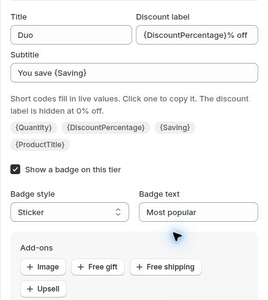

# Offer Text and Badges

Make each choice easy to understand with clear titles, savings text and badges.

## Heading and subheading

Use **Heading** to introduce the offer. Add an optional **Subheading** when shoppers need more context. **Bundle name** is for internal identification.

## Tier text

Edit **Title**, **Discount label** and **Subtitle**. Keep the wording consistent with the actual quantity, price and included products.

Supported fields expose shortcodes such as **{Quantity}**, **{DiscountPercentage}**, **{Saving}** and **{ProductTitle}**. Buy X Get Y also offers **{X}** and **{Y}**. Review the substituted preview after editing.

## Badges

Enable the badge and choose **Ribbon**, **Sticker** or **Pill**. Edit the badge text to highlight the choice you want shoppers to notice.

Tier text, shortcodes, badges and add-ons in the Offer editor.

## Images

The tier's **Image** controls include **Upload** and **Product image**. Review the available option in your editor and confirm the saved result before publishing.

A tier image is separate from the Shopify product image. For a missing offer on an imageless product, see [My offer is not showing](../troubleshooting/offer-not-showing.md).
