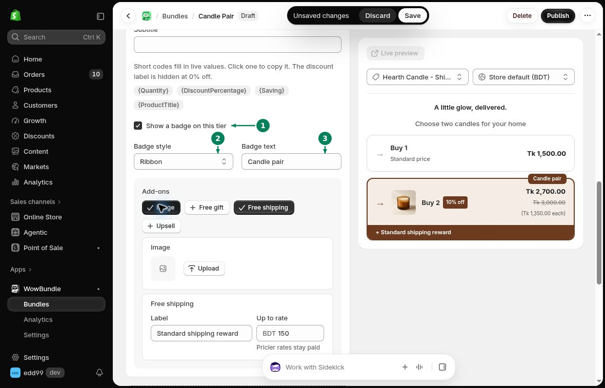
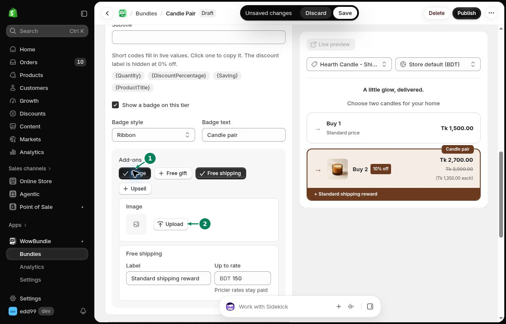

# Text, Badges, and Images

Edit the wording and images in **Offer** to help customers compare your tiers.

## Content

- **Heading**: The title above the offer.
- **Subheading (optional)**: A short line below the heading.
- **Bundle name**: The name used in your bundle list and Shopify discounts.

## Tier text

Expand a tier to edit its text:

- **Title**: The name of the tier, such as “Buy 3”.
- **Discount label**: The savings text beside the title.
- **Subtitle**: More detail below the title.

Short codes fill in values for you. Use the codes shown below the fields, such as **{Quantity}**, **{DiscountPercentage}**, **{Saving}**, and **{ProductTitle}**. Buy X Get Y tiers also offer **{X}** and **{Y}**.

For example, “Buy {Quantity}” uses the tier's quantity. Check the preview after editing. The discount label is hidden at 0% off.

## Badges

1. Turn on **Show a badge on this tier**.
2. Choose a **Badge style**: **Ribbon**, **Sticker**, or **Pill**.
3. Enter your **Badge text**, such as “Best value”.

## Images

1. Under the tier's **Add-ons**, turn on **Image**.
2. Click **Upload** to choose an image.

Click **Save** after making your changes.
