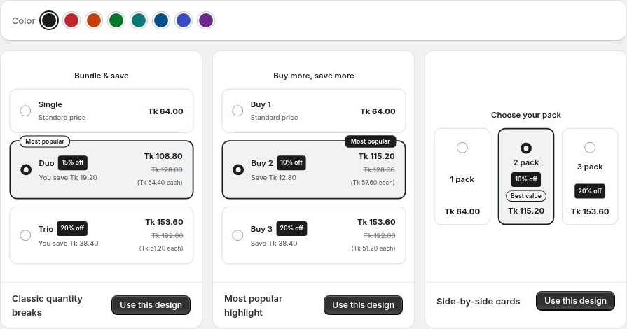

# Create a Bundle

Start with a design, choose your products and build an offer that fits your store.

## Step 1: Choose a design

Open WowBundle and click **Create bundle**. Choose a starting design using its **Use design** action.

Choosing a design creates a Draft. You can return to it from the bundle list even if you leave before publishing.

Choose a starting design from the gallery.

## Step 2: Choose your products

In **Offer → Applies to**, choose **All products**, **Collections** or **Specific products**. Review the selected products before continuing.

## Step 3: Configure the tiers

Open each tier and choose its type, quantity, products and discount. Select the tier that should be **Selected by default**.

Add more choices with **Add tier**, or start from an existing choice with **Duplicate**.

## Step 4: Customize the offer

Edit the heading and tier text. Use **Design** for layout, colors and spacing. Use **Advanced** for checkout naming and price-display options.

## Step 5: Save and publish

Save your changes and review the saved offer. When ready, click **Publish**. Visit an eligible product page and check the offer, cart and checkout summary.

Use the [launch checklist](launch-checklist.md) before making a new offer available broadly.
