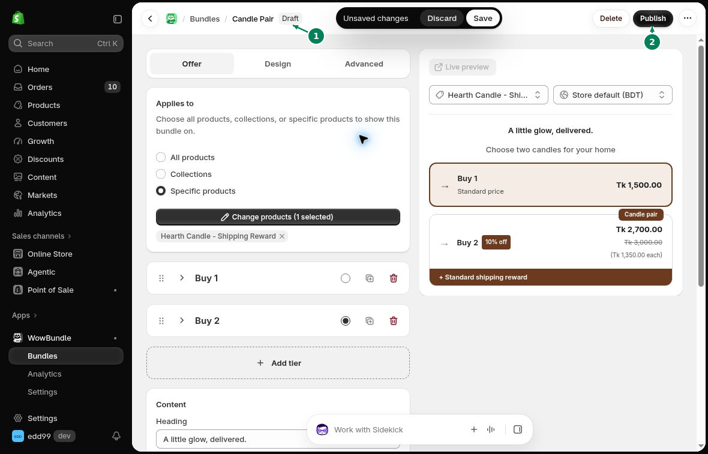

# Create a Bundle

Start with a design, then choose the products, quantities and prices for your offer.

## Choose a design

In Shopify admin, open **Apps → WowBundle**, then click **Create bundle**. Choose a design and click **Use this design (1)**.

This creates a **Draft**. You can return to it later from the bundle list.

## Choose products and tiers

In **Offer → Applies to**, choose **All products**, **Collections** or **Specific products**. Select the collections or products if needed.

Open a tier and choose its **Tier type**:

- **Volume:** several items of the same product.
- **Buy X Get Y:** items customers buy, plus items they get.
- **Bundle:** a set of different products.

Set the quantity and discount. Use **Add tier** for another choice, then choose **Selected by default** on the tier you want selected first.

[Learn how to set up each bundle type](../bundle-types/overview.md).

## Change the appearance

Edit each tier's **Title** and **Subtitle** to describe the offer. Open **Design** to choose the layout and colors.

## Save and publish

Click **Save**, then reopen the bundle to check your settings. While it is a **Draft (1)**, it is not yet available to customers. When it is ready, click **Publish (2)**.

Open a product page included in the offer. Choose a tier and add it to the cart. Check the items, quantities and prices using the [launch checklist](launch-checklist.md).
