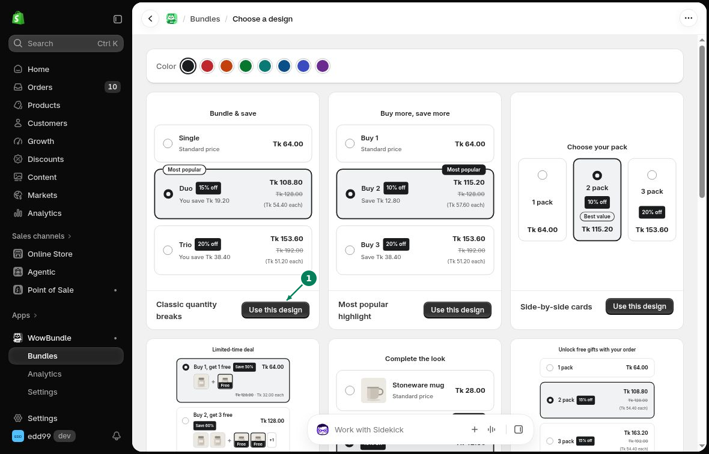

# Choose a Starting Design

A starting design gives you a ready-made layout and sample tiers. Change the products and prices to suit your offer.

## Choose a design

Open **Create bundle** to see the gallery. Each card shows a preview and a **Use this design** button.

- **Classic quantity breaks:** stacked quantity choices.
- **Most popular highlight:** a highlighted choice with a badge.
- **Side-by-side cards:** quantity choices next to each other.

Click **Use this design (1)** below the design you want. WowBundle creates a draft and opens the editor.

## Make it your own

In **Offer**, choose the products, then set each tier's quantity and discount. Replace the sample titles and labels with text that matches your prices.

In **Design**, change the layout, colors and spacing. You can keep the starting design's appearance or adjust it to match your store.

[Continue with your first bundle](create-first-bundle.md).
