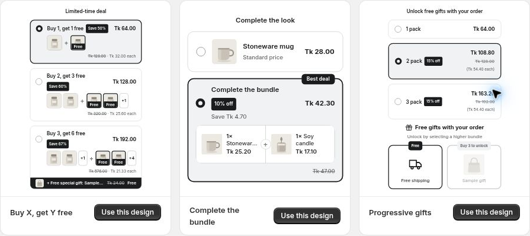

# Choose a Starting Design

Choose the starting point closest to the offer you want, then adjust its settings.

| Design | Start here when you want to… |
| --- | --- |
| Classic quantity breaks | Offer several quantities of one product |
| Most popular highlight | Emphasize a preferred tier |
| Side-by-side cards | Present choices side by side |
| Buy X, get Y free | Configure bought and bonus quantities |
| Complete the bundle | Combine complementary products |
| Progressive gifts | Add rewards at quantity thresholds |
| Free gift deal | Include a gift with a qualifying tier |
| Countdown urgency | Start with urgency-focused offer copy |
| Tiers + checkbox upsell | Offer an optional add-on |
| Fixed price packs | Start with pack-style choices and review their pricing |
| Minimal horizontal | Use a compact horizontal presentation |

Always review the generated quantities, discount modes, products and targeting. A design name does not replace the settings inside the offer. In particular, review the discount mode for pack offers and do not promise a timed promotion unless you have configured a supported timing mechanism.

Design-gallery examples for Buy X Get Y, mixed bundles and progressive gifts.
