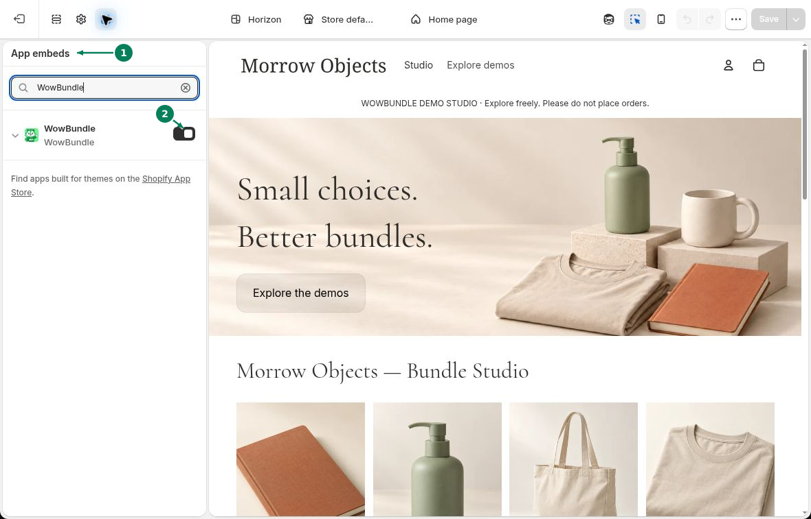
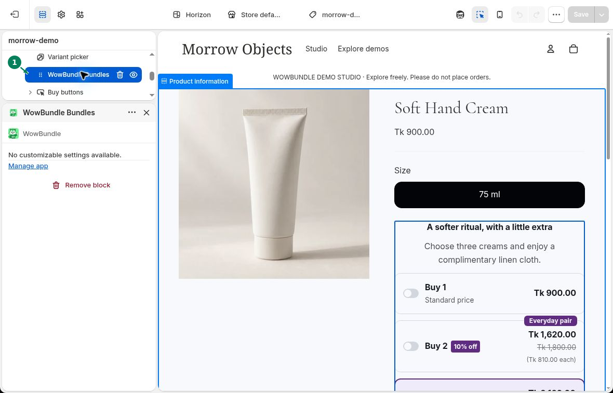

# Theme Setup

Turn on the WowBundle app embed to show active offers on matching product pages. You can also choose where the offer appears with an app block.

## Turn on the app embed

In Shopify admin, open your theme editor.

1. Open **App embeds** and search for **WowBundle**.
2. Turn on the **WowBundle** switch.

Click **Save** to apply the change.

Make sure you are editing the theme your customers use. If you switch themes, turn on the embed in the new theme too.

In **WowBundle → Settings → Theme setup**, **On** means the embed is enabled. **Manage embed** reopens the theme editor. These setup buttons open your published theme.

## Choose the offer's position

With the embed on, offers appear before **Add to cart**. To choose a different position on a compatible product template:

1. Open the product template in the theme editor.
2. In a section that supports app blocks, choose **Add block → Apps → WowBundle Bundles**.
3. Drag the block to the position you want.
4. Preview the product page, then click **Save**.

The image shows the **WowBundle Bundles block (1)** between **Variant picker** and **Buy buttons**.

Keep the app embed on when using the block. Edit the offer's products, prices and appearance in WowBundle; the block has no settings for these.

To return to automatic placement, select the block, click **Remove block**, then **Save**. If your theme does not support app blocks, use automatic placement.

[Offer not showing?](../troubleshooting/offer-not-showing.md)
