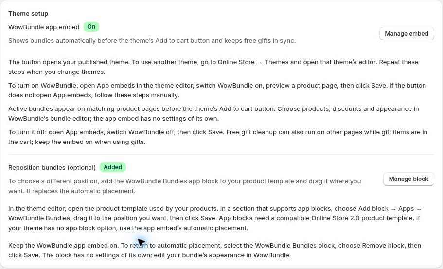

# Theme Setup

Enable WowBundle in your theme so matching offers can appear on your product pages.

## Step 1: Open theme setup

Go to **Apps → WowBundle → Settings** in Shopify admin. Under **Theme setup**, use **Turn on embed** to open the theme editor. If the embed is already enabled, the button is **Manage embed**. Check that you are working on the intended theme.

## Step 2: Enable the app embed

Open **App embeds**, enable WowBundle and click **Save**. Return to WowBundle Settings to check the embed status.

If you change themes, enable the embed in the new theme too.

Theme setup after the embed is enabled. Manage embed reopens the theme settings.

## Step 3: Check your product page

Open a product targeted by an active bundle. Automatic placement is designed to show the offer before the theme's Add to cart button.

## Optional: Choose another position

For more control over placement, add the **WowBundle Bundles** app block to a compatible product template and save the theme. Check which products use that template.

Keep the embed enabled when using the app block. Use the bundle's **Design** tab to change its appearance; the block is for placement.

If your offer does not appear, see [My offer is not showing](../troubleshooting/offer-not-showing.md).
