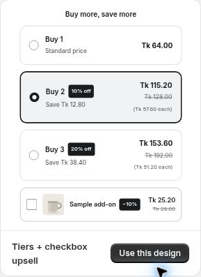

# Checkbox Upsells

Offer an optional product customers can add alongside their chosen tier.

For example, let shoppers add a matching accessory without making it part of every bundle.

Checkbox upsell design-gallery example.

## Step 1: Open Checkbox upsells

Go to **Offer → Extras → Checkbox upsells** and enable the option.

## Step 2: Choose the add-on

Select the product and review its discount, copy and available variant choices.

## Step 3: Save and try both choices

Save the offer. Add it once with the checkbox unselected and once selected. Confirm that the optional product and total match the customer's choice.

Check linked-item behavior when the parent product is removed from cart. Keep the add-on published and available, and recheck its variants after product-option changes.

The tier-level **Upsell** add-on is a separate control from **Extras → Checkbox upsells**. Review the specific control you are using rather than treating them as interchangeable.
