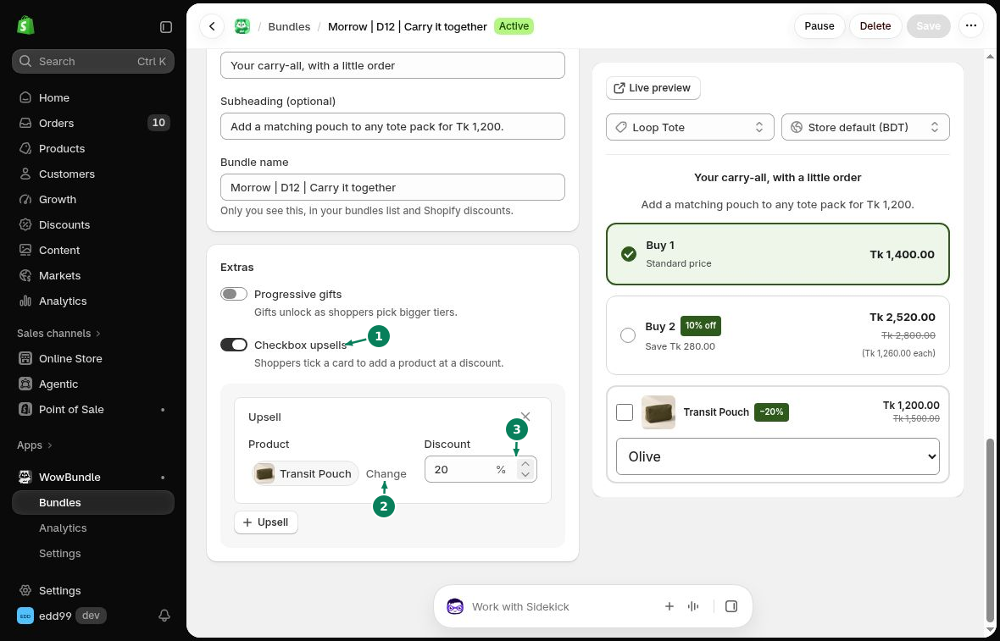

# Checkbox Upsells

Show an optional product below your tiers. Customers tick its checkbox to add it to their order.

## How to add a checkbox upsell

Open **Offer** and scroll to **Extras**.

1. Turn on **Checkbox upsells**.
2. Choose the **Product**. Use **Change** to replace it.
3. Enter the percentage in **Discount**. For example, enter 20 for 20% off.
4. Click **Save**.

Use **+ Upsell** to add another optional product.

## Customer choice

The checkbox starts unchecked. Customers can choose a variant, then tick the checkbox to include the extra product.

To attach an extra product to one tier, use [Tier Upsells](tier-upsells.md).
