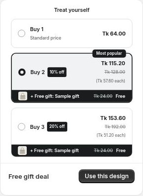

# Free Gifts

Add a product gift to a qualifying tier.

For example, include an accessory when a customer chooses a larger pack.

Free gift design-gallery example.

## Step 1: Open the qualifying tier

In **Offer**, expand the tier that should include the gift.

## Step 2: Add the gift

Enable **Free gift** and select the gift product. Review the available options and gift copy.

## Step 3: Save and check qualification

Save the offer. Add the qualifying tier to cart, then reduce its quantity and check that the gift remains eligible.

Keep the gift published and available. Check both product publication and stock when a gift does not appear.

A tier gift is separate from the received Y items in a Buy X Get Y tier.
