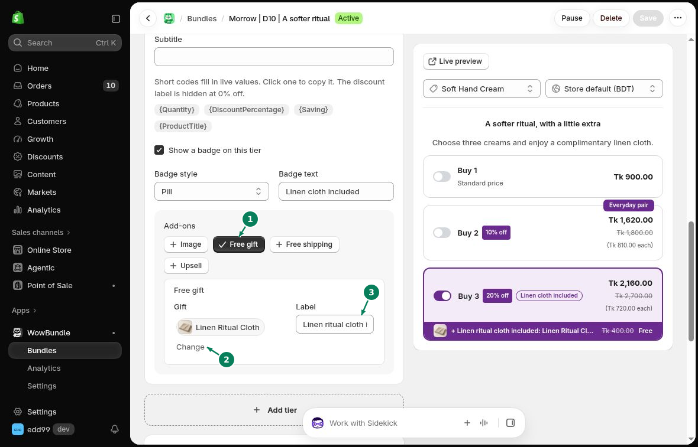

# Free Gifts

Add a free product to a tier, such as a cloth with a three-item pack.

## How to add a free gift

### Step 1: Open the tier

Open your bundle and go to **Offer**. Expand the tier that should include the gift.

### Step 2: Choose the gift

1. Under **Add-ons**, turn on **Free gift**.
2. Choose your product under **Gift**. Use **Change** to replace it.
3. Enter a short **Label**, such as “Cloth included”.

### Step 3: Save the gift

Click **Save**. Open the product page and choose the tier to see the gift with the offer.

To offer gifts at several quantities, use [Progressive Gifts](progressive-gifts.md).
