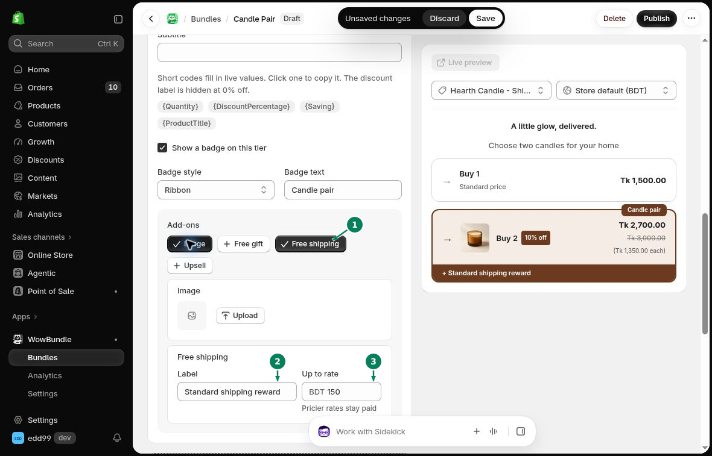
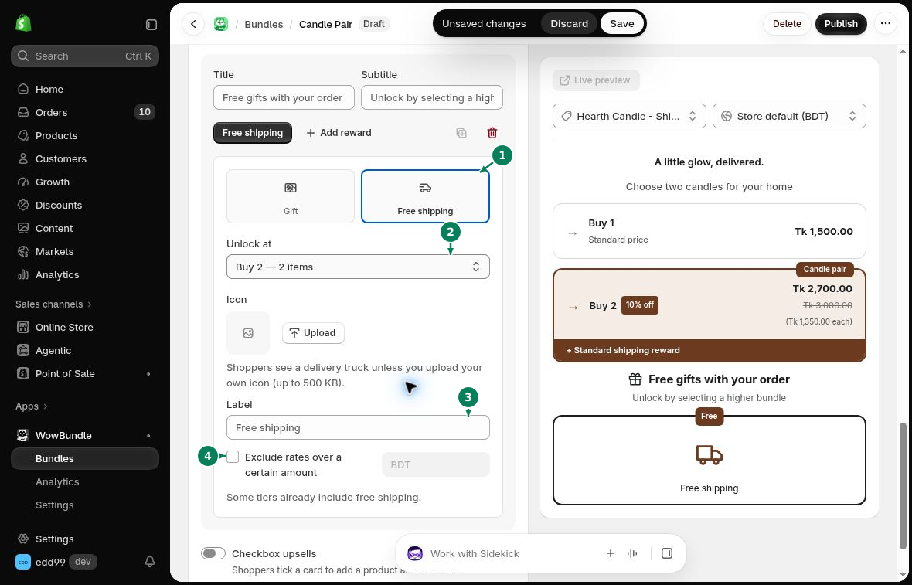

# Free Shipping

Add a shipping reward to a tier or to your progressive rewards.

## Add a tier reward

Open **Offer** and expand the tier.

1. Under **Add-ons**, turn on **Free shipping**.
2. Enter the **Label** customers will see.
3. Set **Up to rate** to the highest shipping rate covered by the reward. The field shows your store currency. Higher rates stay paid.
4. Click **Save**.

## Add a progressive reward

Open **Offer > Extras > Progressive gifts** and click **Add reward**.

1. Choose **Free shipping**.
2. In **Unlock at**, choose the tier that earns the reward.
3. Enter the **Label** customers will see.
4. Turn on **Exclude rates over a certain amount** if you want to set a **Max rate**.

Under **Icon**, keep the delivery truck or click **Upload** to add your own image up to 500 KB.

Click **Save** when you finish.

See [Progressive Gifts](progressive-gifts.md) for setting up the reward list.

Keep the label clear about any shipping limit or conditions.
