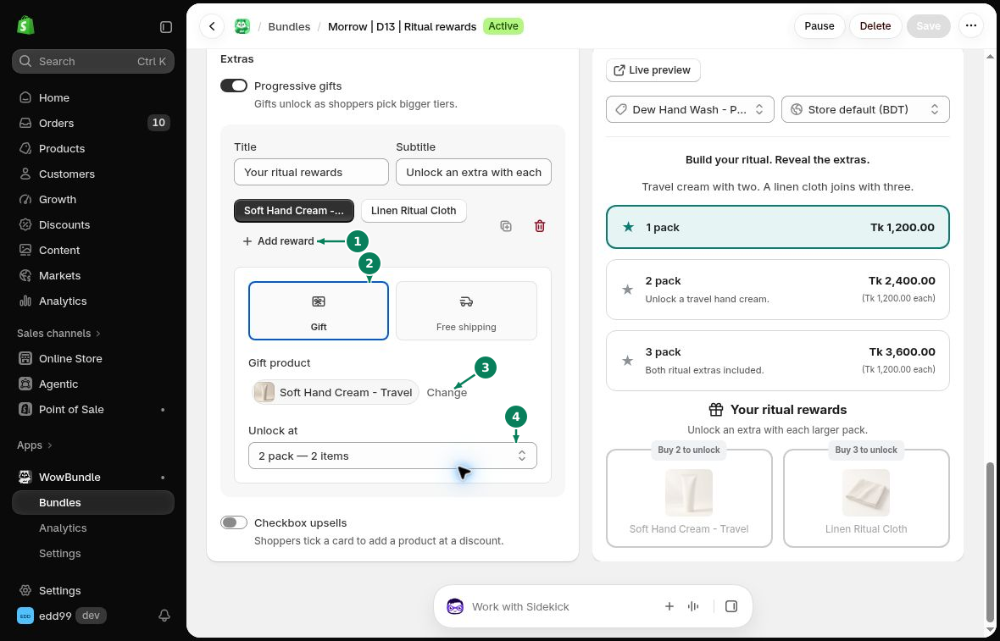
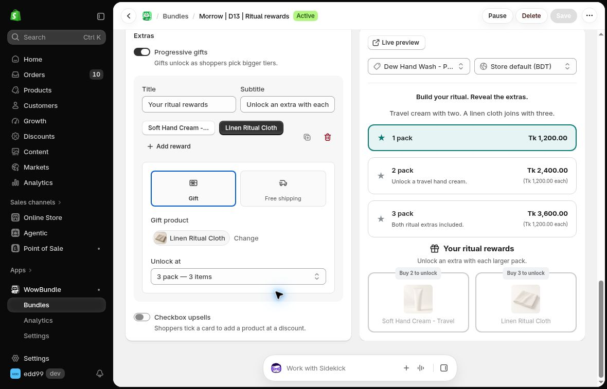

# Progressive Gifts

Give customers rewards as they choose larger packs. For example, include a travel cream with two items and add a cloth with three.

## How to set up progressive gifts

### Step 1: Turn on Progressive gifts

Open **Offer**, scroll to **Extras**, and turn on **Progressive gifts**.

- **Title**: The heading above the rewards.
- **Subtitle**: A short line explaining the offer.

### Step 2: Add a reward

1. Click **Add reward**.
2. Choose **Gift**.
3. Select the **Gift product**. Use **Change** to replace it.
4. In **Unlock at**, choose the tier that earns this gift.

### Step 3: Add the next reward

Click **Add reward** again and choose another gift and tier. Click a reward's name to edit its settings. To remove it, use **Delete reward**.

For example, set the travel cream to the two-item tier and the cloth to the three-item tier.

Click **Save**. Open the product page and select each tier to see which gifts unlock.

## When a customer buys fewer items

A gift can stay in the cart at its regular price when the customer drops below its required quantity. For example, changing a three-item pack to two can leave the cloth in the cart as a paid item.

Try reducing the quantity in the cart before sharing your offer. Keep the required quantity clear in the reward text.

For a shipping reward, see [Free Shipping](free-shipping.md).
