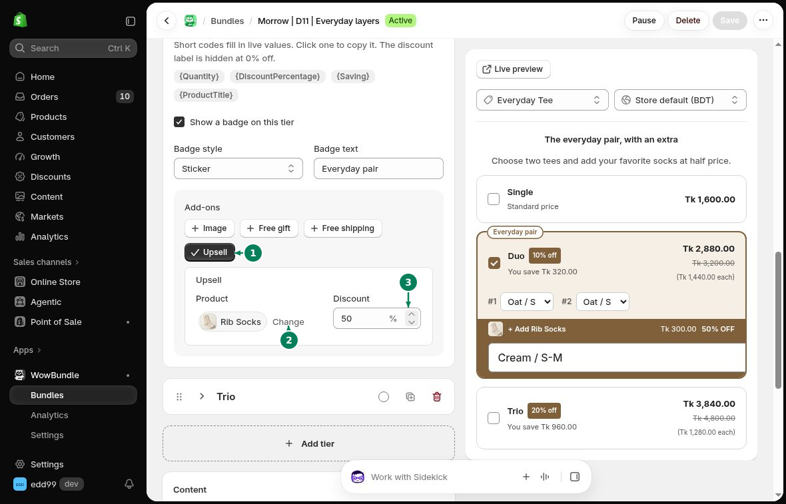

# Tier Upsells

Add an optional discounted product to one tier. For example, offer socks at half price with a two-shirt pack.

## How to add a tier upsell

Open **Offer** and expand the tier.

1. Under **Add-ons**, turn on **Upsell**.
2. Choose the **Product**. Use **Change** to replace it.
3. Enter the percentage in **Discount**. For half price, enter 50.
4. Click **Save**.

## Customer choice

Customers select the tier and choose whether to add the extra product. If it has variants, they can choose one before adding to cart.

The discount depends on the tier's required quantity. If the customer buys fewer items, the extra product can stay in the cart at its regular price.

To show an optional product below all tiers, use [Checkbox Upsells](checkbox-upsells.md).
