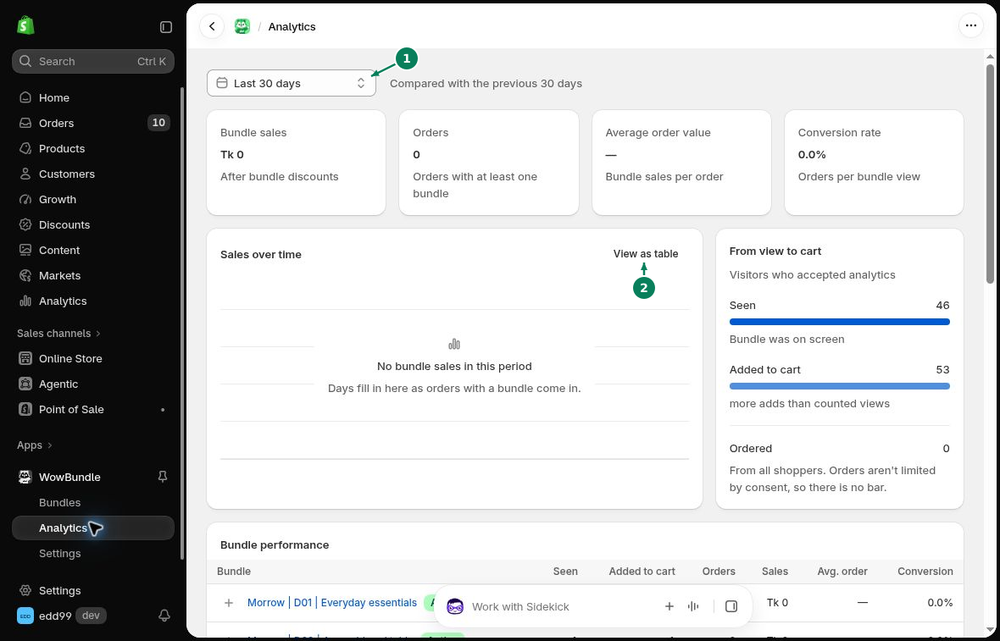
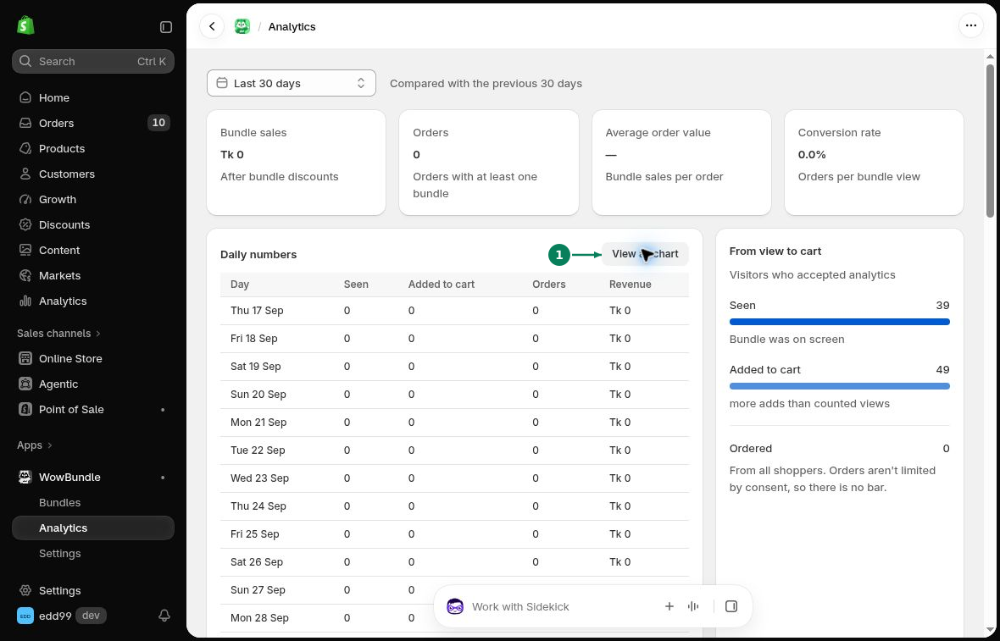
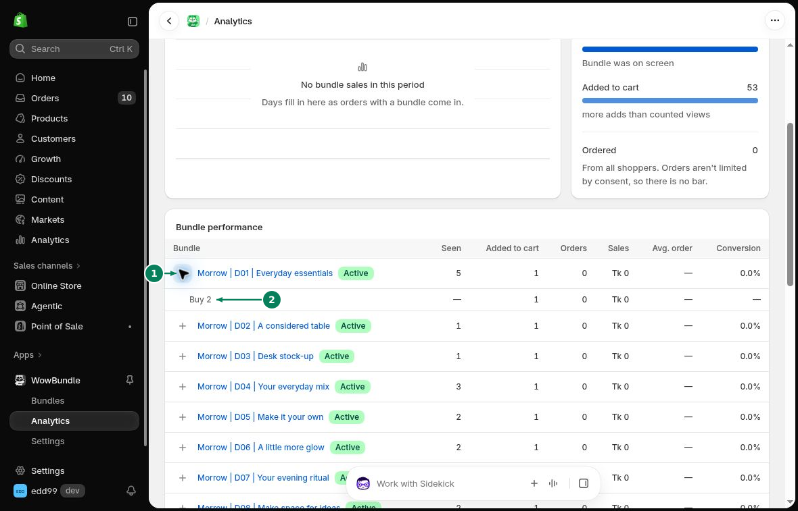

# Analytics

The **Analytics** page shows bundle sales, orders and customer activity. Open **WowBundle > Analytics** to see the results.

## Choose a Date Range

Use the date menu to choose **Today**, **Last 7 days**, **Last 30 days** or **Last 90 days**. For a custom period, select the **From** and **To** dates and apply the range.

1. Choose the date range.
2. Switch the sales chart to a table.

## Sales and Orders

The cards at the top show:

- **Bundle sales:** The value of bundle items when ordered, after discounts, in your store currency. Refunds and cancellations are not subtracted.
- **Orders:** Orders that contain at least one bundle.
- **Average order value:** Bundle sales per order.
- **Conversion rate:** Orders per bundle view.

## Sales Over Time

The **Sales over time** chart shows sales during the selected period. Click **View as table** to see the daily numbers.

Click the marked **View as chart** button to return to the chart.

## From View to Cart

This section shows how customers interact with your offers:

- **Seen:** A bundle appeared on screen.
- **Added to cart:** A bundle was added to the cart.
- **Ordered:** A customer placed an order with a bundle.

The view and add-to-cart counts cover visitors who accepted analytics. Orders include all shoppers. Because these counts cover different groups, they may not match.

Adding a bundle to the cart does not count as an order.

## Bundle Performance

Use **Bundle performance** to compare individual offers. The table shows views, cart adds, orders, sales, average order value and conversion for each bundle.

Click **Show tiers** to see the results for each tier inside a bundle. A dash means a value is not available.

1. Expand a bundle with **Show tiers**.
2. Read the results for its tier.
