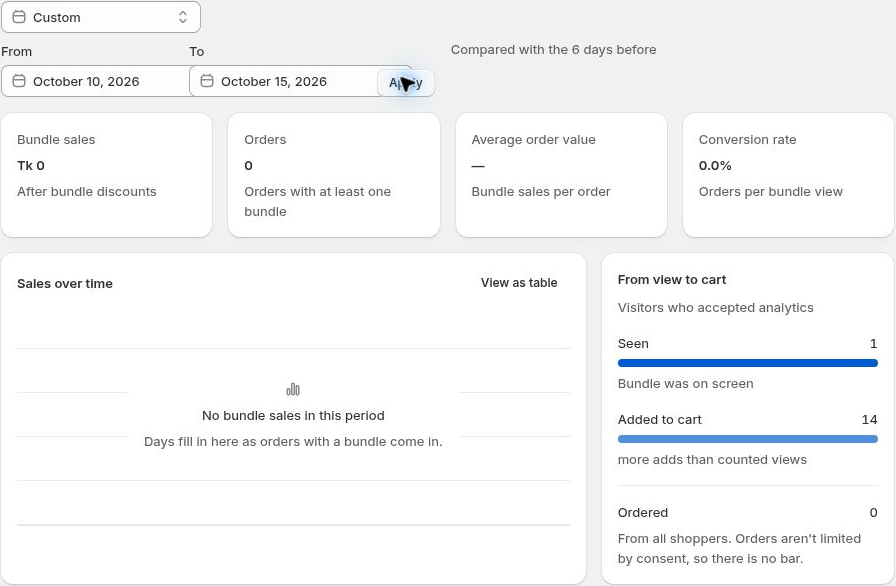

# Analytics

See how customers interact with your bundle offers.

Open **Analytics** from WowBundle's navigation. Review the available views, add-to-cart activity, orders, revenue and conversion metrics.

## Choose a date range

Use the date-range control to select a preset such as Today, last 7 days or last 90 days. For a custom period, select the From and To dates in the calendar and apply the range.

Use the date range, summary metrics and activity views to explore bundle performance.

## Explore the results

Use the available table/chart controls and bundle or tier details to review activity more closely.

## Understand differences

View counts can depend on shopper consent. Check the selected date range and underlying activity before comparing metrics.

An add-to-cart event is not a completed order. If orders or revenue do not match your expectations, compare the relevant orders and offer configuration rather than relying on one summary number.
