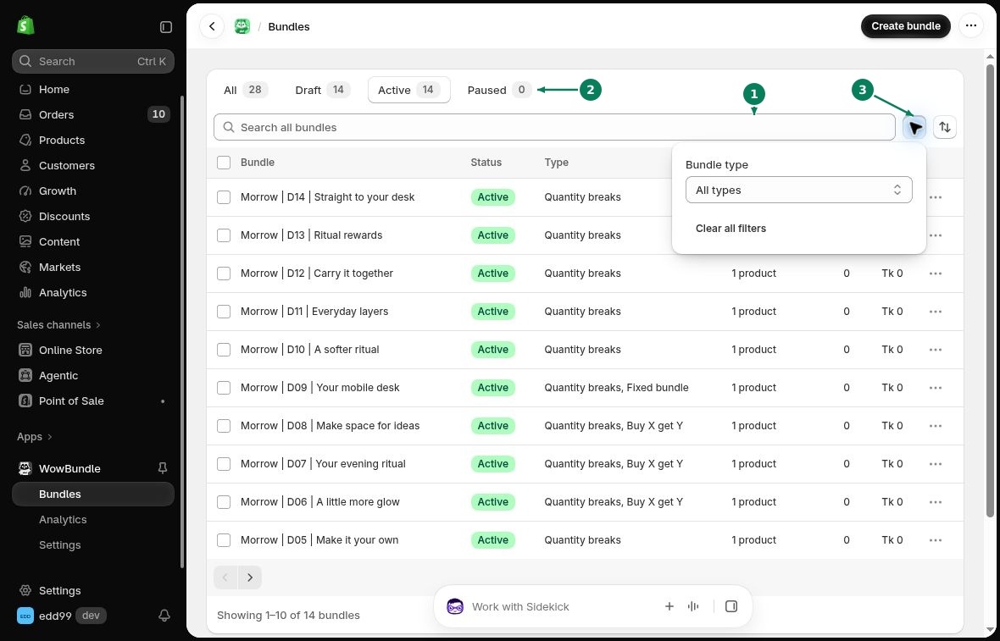
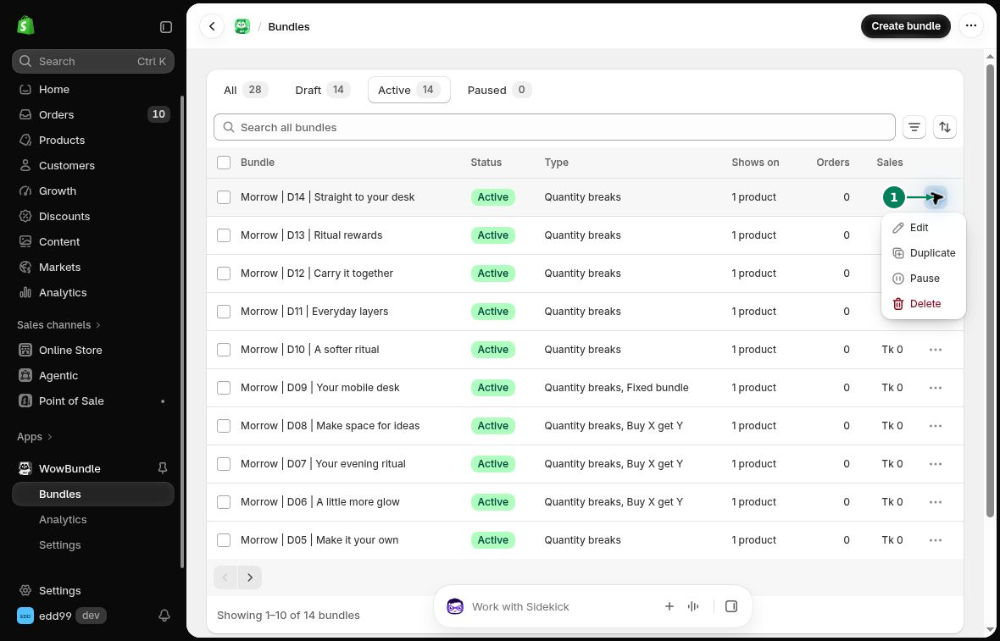

# Manage Bundles

The **Bundles** page lists your saved offers. From here, you can edit an offer, change its status or make a copy.

## Find a Bundle

Open **WowBundle > Bundles**. Use the search field to find a bundle by name.

The status tabs help you narrow the list:

- **All:** Show every bundle.
- **Draft:** Show bundles that have not been published.
- **Active:** Show published bundles.
- **Paused:** Show bundles you have stopped.

Use the type filter to show **Quantity breaks**, **Buy X get Y** or **Fixed bundle** offers. Use the sort menu to order the list by name or creation date.

1. Search for a bundle.
2. Choose a status tab.
3. Open the bundle type filter.

## Edit a Bundle

1. Find the bundle in the list.
2. Open its actions menu and select **Edit**.
3. Make your changes in the editor.
4. Click **Save**.

## Publish, Pause or Resume

Open a bundle and use the action shown for its current status:

- **Publish:** Make a draft offer active.
- **Pause:** Stop an active offer without deleting it.
- **Resume:** Make a paused offer active again.

An active offer appears on products that match its **Applies to** setting. The WowBundle app embed must also be enabled. See [Theme Setup](../getting-started/theme-setup.md).

## Duplicate a Bundle

Open the bundle's actions menu and select **Duplicate**. This creates a draft copy. Change its name, products or prices before publishing it.

Use the marked actions menu to edit, duplicate, pause or delete an offer.

## Delete a Bundle

Select **Delete** from the actions menu. Read the message before you confirm.

Use **Pause** if you want to stop the offer and use it again later.
