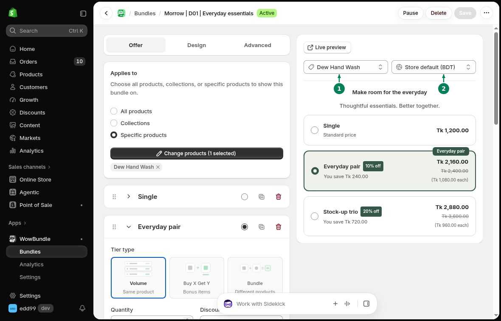

# Country and Currency Preview

The bundle editor lets you preview an offer for a product and country. The available countries and currencies depend on your store.

## Change the Preview

Open a bundle in WowBundle, then use the selectors above its preview:

1. Choose a product.
2. Choose a country.

The preview helps you check the offer's text and prices. Changing the preview does not change your store's market settings.

## Check Your Storefront

Open the product page in the market you want to use. Check the currency, product availability and final checkout total.

If a price looks different, check your Shopify market settings and the selected variant's price.
